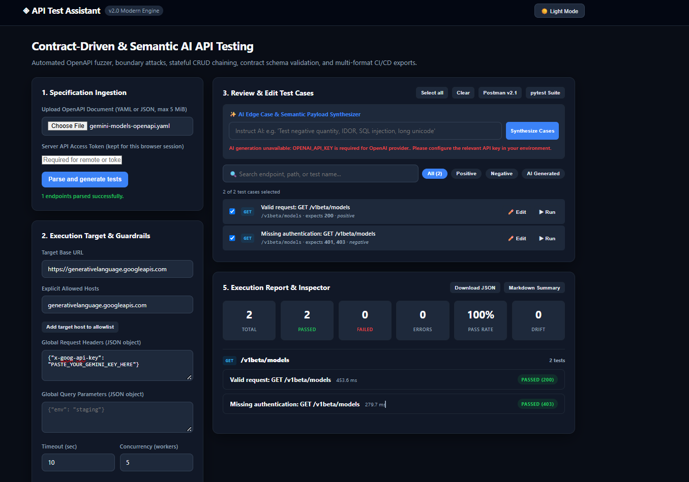

# AI API Testing Assistant

AI API Testing Assistant is a local web app and command-line tool for checking HTTP APIs against an OpenAPI or Swagger contract. It reads the API description, creates test cases, sends requests to a running API, and reports whether the responses match the expected status codes and schemas.

> **This tests APIs, not website screens.** A website may use APIs behind the scenes, but this tool needs an API specification and a reachable API base URL. Use browser automation for visual pages and user flows.

## How it works

1. Upload an OpenAPI YAML or JSON file (or pass one to the CLI).
2. The app parses its paths, operations, request schemas, responses, and declared authentication.
3. It generates positive and negative test cases. Optional AI generation can add domain-specific cases.
4. You choose the tests and provide the running API's base URL and any needed request headers.
5. The app runs the requests, checks status codes and response contracts, and produces a report.

The OpenAPI file describes the API; it does not create or start the API. The API must already be running and accessible to the machine running this tester.

## Example result

The screenshot below shows two checks against Gemini's model-list endpoint: an authenticated request succeeded with HTTP 200, and a request without the API key was rejected with HTTP 403 as expected. This verifies that one endpoint and two behaviors worked; it does not test every Gemini endpoint.



## Features

- **OpenAPI and Swagger support:** Parses YAML or JSON documents, validates specifications, resolves local `$ref` schemas, and extracts operations, parameters, responses, and authentication requirements.
- **Deterministic test generation:** Creates valid requests and negative cases for schema boundaries, required fields, formats, parameters, and missing authentication.
- **Optional AI-assisted cases and diagnosis:** Supports Gemini, Anthropic, OpenAI, and local OpenAI-compatible providers such as Ollama. AI features require the corresponding provider configuration; basic test generation and execution work without an AI key.
- **Contract and assertion checks:** Checks documented response schemas, expected status codes, response headers, JSON-path assertions, and optional latency thresholds.
- **HTTP execution controls:** Runs batches concurrently, streams progress to the browser, supports individual test runs, and allows explicit review of mutating requests.
- **Stateful workflows:** Chains API operations and passes extracted response values between steps, with teardown steps for cleanup.
- **Reports and exports:** Provides an execution summary and exports results or suites as JSON, JUnit XML, Markdown, Postman Collection v2.1, and pytest.
- **Web interface and CLI:** Use the dark/light browser UI for interactive testing or run tests from a terminal or CI job.

## Quick start (Windows PowerShell)

From the project directory:

```powershell
py -m venv .venv
.\.venv\Scripts\Activate.ps1
python -m pip install -r requirements.txt
Copy-Item .env.example .env
```

Open `.env` and set `ALLOWED_HOSTS` to the exact hostnames this local tester is allowed to call. For example:

```ini
ALLOWED_HOSTS=127.0.0.1,localhost,generativelanguage.googleapis.com
```

Only include hosts you intend to test. The server-side allowlist is required for execution; the browser's **Explicit Allowed Hosts** field can narrow it but cannot add hosts the server has not allowed. Private and localhost targets are blocked unless the server operator deliberately enables `ALLOW_PRIVATE_NETWORK_TARGETS=true`.

Start the app:

```powershell
python -m uvicorn app.main:app --reload
```

Open [http://127.0.0.1:8000](http://127.0.0.1:8000). FastAPI's interactive API docs are available at [http://127.0.0.1:8000/docs](http://127.0.0.1:8000/docs).

### Try Gemini's model-list API

The repository includes a [minimal Gemini OpenAPI example](docs/examples/gemini-model-list.yaml) for `GET /v1beta/models`. It checks only the model-list operation; use a fuller specification to cover additional endpoints.

1. Obtain a Gemini API key from [Google AI Studio](https://aistudio.google.com/api-keys).
2. Upload [`docs/examples/gemini-model-list.yaml`](docs/examples/gemini-model-list.yaml) in the browser and choose **Parse and generate tests**.
3. Set **Target Base URL** to `https://generativelanguage.googleapis.com`.
4. Set **Explicit Allowed Hosts** to `generativelanguage.googleapis.com` and add it to the target allowlist.
5. In **Global Request Headers**, enter `{"x-goog-api-key":"YOUR_KEY"}`. Replace the placeholder locally; do not commit or share your key.
6. Select the valid request to check HTTP 200. Select the missing-authentication case to check that the API rejects a request without the key.

The **Server API Access Token** field is for protecting this tester's own API; it is not the Gemini key. When using the app locally without `API_ACCESS_TOKEN`, leave that field blank. The Gemini key goes in the target request header above. Setting `AI_PROVIDER=gemini` is only necessary when you want Gemini to power optional AI-generated cases or failure analysis.

## Environment configuration

`.env.example` documents the available settings. Copy it to `.env` and set only the providers and targets you need.

| Variable | Purpose |
| --- | --- |
| `ALLOWED_HOSTS` | Comma-separated hostnames this server may test. Required for web execution. |
| `ALLOW_PRIVATE_NETWORK_TARGETS` | Enables private/loopback target testing when set to `true`; use only on a trusted local instance. |
| `API_ACCESS_TOKEN` | Optional bearer token for this tester's API. Without it, API requests are restricted to loopback. Configure it before exposing the app to a network. |
| `AI_PROVIDER` | Optional provider for AI-assisted test generation or failure diagnosis: `auto`, `gemini`, `anthropic`, `openai`, `ollama`, or compatible local provider. |
| `GEMINI_API_KEY`, `ANTHROPIC_API_KEY`, `OPENAI_API_KEY` | Provider credentials used by optional AI features. Keep secrets in `.env` or your deployment's secret manager. |
| `GEMINI_MODEL`, `ANTHROPIC_MODEL`, `OPENAI_MODEL` | Optional model selection for the corresponding provider. |
| `LOCAL_LLM_URL`, `LOCAL_LLM_MODEL` | Optional local OpenAI-compatible model endpoint and model name. |
| `LOG_LEVEL`, `HOST`, `PORT` | Logging and server settings. |

The `.env` file is ignored by Git. Do not put secrets in OpenAPI documents, screenshots, or committed files. Credentials for the API being tested are supplied as request headers or query parameters in the UI/CLI; they are distinct from the AI provider credentials.

## CLI usage

Run a suite and write reports:

```powershell
python -m app.cli run `
  --spec petstore.yaml `
  --base-url https://api.example.com `
  --allowed-hosts api.example.com `
  --output-junit results.xml `
  --output-markdown summary.md `
  --output-json report.json
```

Supply an API key as a request header when required:

```powershell
python -m app.cli run `
  --spec openapi.yaml `
  --base-url https://api.example.com `
  --allowed-hosts api.example.com `
  -H "Authorization: Bearer YOUR_API_TOKEN"
```

Export a Postman collection or a pytest file:

```powershell
python -m app.cli export --spec openapi.yaml --format postman --output postman_collection.json
python -m app.cli export --spec openapi.yaml --format pytest --output test_generated_api.py
```

Run `python -m app.cli --help`, `python -m app.cli run --help`, or `python -m app.cli export --help` for all options. Avoid placing real secrets directly in shell history; use a secure environment or a protected CI secret where appropriate.

## Security and deployment notes

- The executor validates target addresses and pins connections to validated DNS results to reduce SSRF and DNS-rebinding risk.
- Web execution uses the server-owned `ALLOWED_HOSTS` allowlist. A browser request cannot expand it.
- Mutating HTTP methods (`POST`, `PUT`, `PATCH`, and `DELETE`) require explicit permission in the run configuration. Use a staging API or disposable test data when testing operations that change state.
- Redirects are disabled, response reads are bounded, and sensitive credentials are scrubbed from execution results.
- Optional AI failure analysis receives sanitized test metadata rather than raw credentials or request/response bodies.
- For personal use, running locally is the simplest deployment. Before hosting this tester publicly, configure `API_ACCESS_TOKEN`, restrict `ALLOWED_HOSTS`, use HTTPS, and review the deployment platform's function-duration and networking limits. Do not expose an unauthenticated API-testing proxy to the internet.

### Deploy to Vercel

The repository includes a Vercel configuration for the FastAPI entry point, the UI HTML asset, and exclusion of local environments, tests, and documentation from the serverless bundle. Vercel's Python runtime supports FastAPI and response streaming, subject to Vercel Function duration and bundle limits.

1. Push the repository to a Git provider and import it into Vercel. Vercel should detect the FastAPI app at `app/main.py`.
2. In the Vercel project's **Settings → Environment Variables**, add:
   - `API_ACCESS_TOKEN`: a long, random secret. Enter the same value in the browser's **Server API Access Token** field when using the deployed app.
   - `ALLOWED_HOSTS`: comma-separated exact target API hostnames, such as `generativelanguage.googleapis.com`. Only these hosts can be tested by this deployment.
   - `ALLOW_PRIVATE_NETWORK_TARGETS`: `false`.
3. Add provider credentials such as `GEMINI_API_KEY` only if you want Gemini to generate or analyze tests. Credentials for the target API itself are entered as request headers in the UI.
4. Deploy a preview first. Confirm the homepage and `/docs` load, then run a small request against an API host listed in `ALLOWED_HOSTS`.
5. If the app is for personal use, enable Vercel deployment protection so only you can open it. Keep the server token private and do not publish it in the repository.

The target allowlist is a server-side security boundary, so a deployed instance cannot test arbitrary hostnames. Long test batches may also exceed a serverless function's maximum duration; start with small batches and check the limits for your Vercel plan.

## Run the test suite

```powershell
python -m unittest discover tests
```

## Project layout

```text
app/
  ai/          AI provider adapters
  analysis/    Privacy-conscious failure analysis
  api/         Upload, execution, workflow, generation, and export routes
  executor/    HTTP execution, batch streaming, and contract validation
  generator/   Deterministic and AI-assisted case generation
  models/      Request, test-case, workflow, and result models
  parser/      OpenAPI loading, validation, and extraction
  report/      Summary and report exporters
  ui/          Browser interface
  cli.py       Command-line runner and exporters
tests/         Unit and integration tests
```

See [`PROJECT_ROADMAP.md`](PROJECT_ROADMAP.md) for implementation details and operational follow-up.
